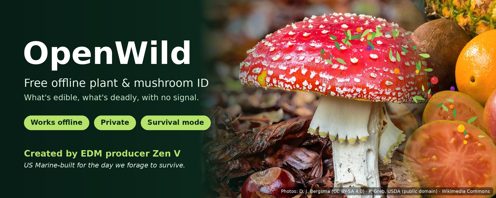

<p align="center"></p>

# OpenWild

**Free, offline plant and mushroom identification for everyone — built for the moment you have no signal and need to know what you're looking at.**

*Created by EDM producer **Zen V**. "I'm a US Marine, and we may be foraging for survival one day. This is the go-to app. Hope you enjoy."*

OpenWild is a free, open-source, non-commercial Android app. Point the camera at a plant or mushroom, take a few photos, and the app tells you what it most likely is, how confident it is, and what happens if it's eaten — harms first. Everything runs on the phone. No account, no ads, no tracking, no internet required after you download your region.

> "OpenWild" is a working name. To rename, change `app_name` in `android/app/src/main/res/values/strings.xml` and `applicationId` in `android/app/build.gradle.kts`.

## Install on Android

1. On your phone, download **[OpenWild.apk](https://github.com/zenv99/openwild/releases/download/app-latest/OpenWild.apk)**, open it, and allow installing from this source.
2. **Automatic updates:** install [Obtainium](https://github.com/ImranR98/Obtainium) (free, open source), tap *Add app*, paste `https://github.com/zenv99/openwild`. Obtainium checks for new releases and installs them. OpenWild itself never goes online.

Every build gets a new version number and a release (`v0.6.N`), checked automatically for no internet permission, no backup and no debug mode.

## What it does

- **Photo ID, fully offline.** A small on-device model (~10–25 MB) turns each photo into a fingerprint and matches it against a regional reference library.
- **Several photos, more confidence.** Take 1–5 shots (leaf, flower, fruit, whole plant; or cap, gills, stem, base). Results are fused across photos.
- **Honest confidence.** Every result shows a calibrated confidence score and a tier: High, Medium, Low, or "Not in our library".
- **Region downloads like Organic Maps.** Browse by continent, search countries, see sizes, update all. The app suggests your region from GPS (offline) and downloads only that region's species (typically 5–30 MB).
- **Photos for every species.** A photo grid in Explore, thumbnails in every list, photo rows on the home screen ("Food you can find here", "Deadly here — learn these"), and a full-screen, pinch-to-zoom viewer with the photographer and licence credited. Field photos from iNaturalist come first; herbarium sheets only when nothing else exists. All photos live inside the region pack, offline.
- **Explore offline.** Search every species in your region; filter by deadly, survival, plants, mushrooms, psychoactive. Switch between photo grid and list.
- **Dark mode by default**, light and system themes too.
- **Contribute privately.** Share a sighting (e.g. to iNaturalist) or report a wrong ID — only when you tap it. Nothing is ever sent automatically.
- **"If eaten" for every species.** Benefits, harms (with symptom onset timing and what to do), and what it feels like — including clear legal warnings for psychoactive species.
- **Survival mode.** Puts safe high-value plants, deadly species, and water/fire/shelter/medicinal uses first.
- **Safety first, always.** Harms before benefits. Deadly lookalikes always shown. Full "If eaten" details only at High confidence. See [SAFETY.md](SAFETY.md).

## Repository layout

```
android/     Android app (Kotlin, Jetpack Compose, CameraX, LiteRT)
pipeline/    Python data pipeline: data download, model distillation, region pack builder
content/     Curated species safety content (edibility, toxicity, effects) — expert review required
regions/     Region definitions (GBIF filters + bounding boxes)
docs/        Architecture, pack format, confidence scoring, content schema
```

## How it works (one paragraph)

A large open biology model (BioCLIP 2, MIT license) is used once, offline, as a *teacher* to train a small mobile *student* model that produces compatible image fingerprints. For each region, the pipeline pulls the region's species list from GBIF, gathers openly licensed reference photos from the iNaturalist Open Dataset, turns them into a handful of fingerprints per species ("prototypes"), and packages them with species safety content into a single SQLite file. The app matches your photos against those prototypes, applies a where/when prior, and reports a calibrated confidence. Adding data means rebuilding a pack — no app update and no retraining needed. Details: [docs/ARCHITECTURE.md](docs/ARCHITECTURE.md).

## Quick start

### App
```bash
cd android
./gradlew testDebugUnitTest assembleDebug     # needs JDK 17 + Android SDK (Android Studio installs both)
```
Put the exported model at `android/app/src/main/assets/embedder.tflite` (produced by the pipeline). Without it the app builds and runs but shows "Model not installed".

### Pipeline
```bash
cd pipeline
python -m venv .venv && source .venv/bin/activate
pip install -r requirements.txt
python -m openwild_pipeline.cli --help
```
Full walkthrough: [pipeline/README.md](pipeline/README.md).

## Before the first public release

1. Create the GitHub org/repo and set the pack index URL in `android/app/build.gradle.kts` (`packIndexUrl`).
2. Run the pipeline for the launch regions; upload packs + `index.json` to a Release tagged `packs`.
3. Export the model into `android/app/src/main/assets/embedder.tflite` and build a signed release APK/AAB.
4. **Expert review of all content in `content/curated/`** (status must read `expert_reviewed`).
5. Field-test in at least 3 regions (tropical, temperate, arid); tune thresholds via `calibrate`.
6. Have counsel confirm data licensing (DATA_SOURCES.md) and the app's disclaimers.
7. Replace the placeholder launcher icon.

## Zero-cost operation

| Need | Free option |
|---|---|
| Training / embedding compute | Kaggle Notebooks or Google Colab free GPUs |
| Raw data | iNaturalist Open Dataset on AWS (no account), GBIF API |
| Hosting region packs | GitHub Releases (packs are public files) |
| Code hosting + CI | GitHub + GitHub Actions |
| Distribution | Google Play ($25 one-time developer fee), F-Droid (free), GitHub APK |

## Support

OpenWild is free with no ads. Tips over Bitcoin Lightning: **zenv9@cake.cash**

Feedback: open an issue (in-app **About → Send feedback** does this for you).

> Google Play restricts in-app donation links for individuals. Build Play releases with `-PshowDonations=false`; keep the tip button in GitHub/F-Droid builds.

## Automation

- **Weekly open-data buckets** (Sundays): walks Wikipedia categories in English and Indonesian (edible fruits, vegetables, nuts, spices, herbs, edible/poisonous/deadly/psychoactive mushrooms, poisonous plants, medicinal and fibre plants), maps every article to its species through Wikidata, and turns them into one-line verdicts. Poisonous always beats edible; genus-level hits only add warnings.
- **Weekly data bot** (Sundays): adds 30–40 new species safety entries and missing regions, validates them, and opens a pull request for human review. Progress: [COVERAGE.md](COVERAGE.md).
- **Monthly optimizer** (1st of each month): updates dependencies, improves speed, size, UI and accessibility, and opens a pull request. Safety rules are off-limits to it.

## License

- **Code:** Apache License 2.0 — see [LICENSE](LICENSE).
- **Data in region packs:** each reference photo keeps its original Creative Commons license and attribution. Because many sources are *NonCommercial*, OpenWild and its packs must stay **free and non-commercial**. See [DATA_SOURCES.md](DATA_SOURCES.md).

## Disclaimer

OpenWild is an identification aid, not an authority. **Never eat anything based only on this app.** Identification from photos can be wrong, and some deadly species look almost identical to edible ones.
